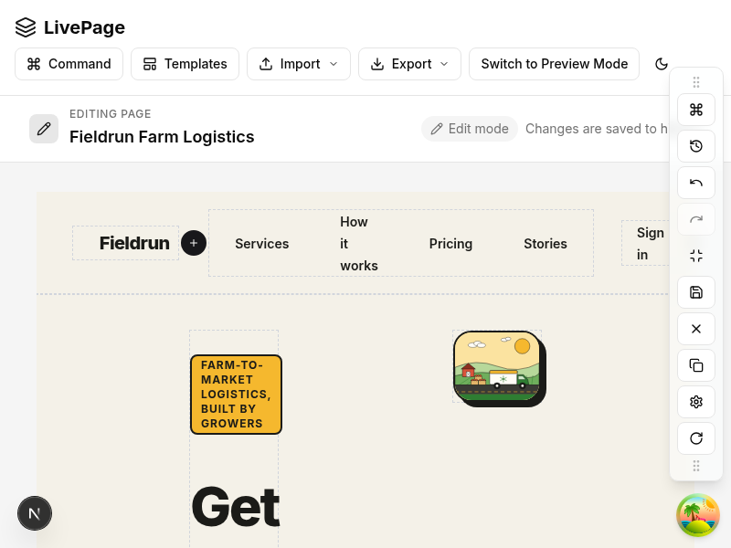

# Divider thickness is pinned inline and the + button is out of flow

**Status:** Accepted, amended by [ADR 0015](./0015-dividers-are-layout-neutral.md) (hidden state). Supersedes [ADR 0013](./0013-fixed-divider-thickness.md).

Issue #403: a vertical insertion divider rendered far wider than intended inside rows of the
`farm-logistics-landing-page` template, pushing the layout apart. [ADR 0013](./0013-fixed-divider-thickness.md)
replaced `w-2`/`h-2` with `w-[2px]`/`h-[2px]`, which did not fix it.

## Cause

The divider bar is a flex item whose only child is a `size-7` (28px) "+" button in normal flow.
A flex item's `min-width: auto` resolves to its content size, so the bar could never be narrower
than the button, whatever `width` said. Changing the unit changed nothing; the utility class was
never the binding constraint.

## Decision

- The bar's thickness (`width` for vertical, `height` for horizontal) is set with **inline
  styles**: `width`/`min-width`/`max-width` (or the height equivalents) and `flex: 0 0 2px`, from
  `getDividerThicknessStyle`. Inline styles are not overridden by utilities, `flex-1`, `self-stretch`
  or `[&>*]` rules from parent layouts.
- The "+" button is `absolute`, centred on the bar, so it does not contribute to the bar's
  content size. The bar does not clip, so the button stays fully visible and clickable.
- The 2px value lives in one constant, `DIVIDER_THICKNESS_PX`.
- While hidden, the bar keeps its `size-0` classes, gets no inline thickness, and is taken out of flow (see ADR 0015).

## Consequences

- Dividers keep a 2px thickness in rows, columns, wrapping rows and grids.
- Jest (jsdom) does not compute layout, so unit tests assert the pinned styles and the out-of-flow
  button. Visual verification is the `farm-logistics-landing-page` template in Edit Mode, hovering
  a vertical divider.

## Visual verification

Hover state of a vertical divider in the `farm-logistics-landing-page` template (Edit Mode):

The bar is 2px wide; the + button is centered and out of flow.
